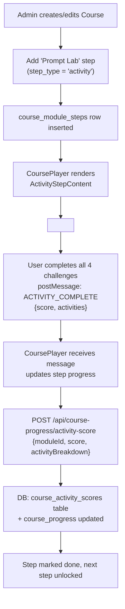

# 🧩 Activity Lab → Prompt Engineering Module Integration Plan

> **Purpose:** A precise, agent-ready blueprint to integrate the standalone 4-activity Prompt Engineering Lab (`activity/index.html`) as a native, tracked step inside the Compliance Agent v2 course player.

---

## 📌 Executive Summary

The `activity/index.html` is a self-contained, single-page gamified lab containing 4 sequential prompt engineering challenges:
1. **Block Builder** — Drag & drop prompt component assembly
2. **Robot Rescue** — Rewrite a broken prompt, live robot feedback
3. **Ingredient Lab** — Drag correct vials into a cauldron
4. **Sprint Challenge** — 60-second timed prompt writing

The Compliance App's **CoursePlayer** (`course-player.tsx`) renders a series of `CourseStepRow` typed steps (pdf, video, mindmap, scenarios, infographic, quiz). Each step maps to a DB row in `course_module_steps`.

The goal: add a new `"activity"` step type that serves the HTML lab **as an iframe**, reports completion back via `postMessage`, and saves a per-user activity score to the DB — following the exact same pattern as the existing `html` / `scenarios` embed steps.

---

## 🗺️ Architecture Overview



---

## 📂 Files to Touch / Create

### 🆕 New Files to Create

| File | Purpose |
|------|---------|
| `public/activity/index.html` | Copy of `activity/index.html`, patched to emit `postMessage` on completion |
| `src/components/employee/activity-step-content.tsx` | React component that wraps the iframe, listens to `postMessage`, fires progress callback |
| `src/app/api/course-progress/activity-score/route.ts` | API endpoint to persist activity scores |
| `src/lib/activity-embed.ts` | Shared constants & types for the postMessage protocol |

### ✏️ Files to Modify

| File | Change Required |
|------|----------------|
| `src/lib/course-step-types.ts` | Add `"activity"` to `CourseStepType` union and `COURSE_STEP_ORDER` |
| `src/lib/db/schema-course.sql` | New `course_activity_scores` table + column on `course_module_steps` |
| `src/components/employee/course-step-content.tsx` | Add `activity` case to the step-type renderer switch |
| `src/components/employee/course-player.tsx` | Handle activity step completion callback (score save + advance) |
| `src/app/admin/` _(course builder UI)_ | Allow admins to add/configure an `activity` step |
| `src/lib/course-progress-api.ts` | Add `syncActivityScore()` API helper |

---

## 🔧 Phase 1 — Patch the HTML Lab for Embed

### 1.1 Copy to `public/activity/index.html`

Copy `activity/index.html` verbatim to `compliance_agent_v2/public/activity/index.html`. This makes it accessible at runtime via `/activity/index.html`.

### 1.2 Patch `showResults()` to emit `postMessage`

At the end of `showResults()` in the copied file, append:

```javascript
// ── EMBED BRIDGE ──
function notifyParentComplete() {
  const total = App.scores.reduce((a, b) => a + b, 0);
  const payload = {
    type: 'ACTIVITY_COMPLETE',
    source: 'prompt-lab',
    totalScore: total,
    maxScore: 100,
    activities: [
      { id: 'block-builder',   score: App.scores[0], maxScore: 25 },
      { id: 'robot-rescue',    score: App.scores[1], maxScore: 25 },
      { id: 'ingredient-lab',  score: App.scores[2], maxScore: 25 },
      { id: 'sprint-challenge',score: App.scores[3], maxScore: 25 },
    ],
  };
  window.parent.postMessage(payload, '*');
}
```

Call `notifyParentComplete()` inside `showResults()` after `animateCounter(...)`.

> [!NOTE]
> The `'*'` targetOrigin is safe here because the message payload contains only scores (no auth tokens or PII). The receiving parent validates `source === 'prompt-lab'`.

---

## 🏗️ Phase 2 — TypeScript Types & Constants

### 2.1 `src/lib/activity-embed.ts` (NEW)

```typescript
/** postMessage protocol between the activity iframe and CoursePlayer */

export const ACTIVITY_EMBED_EVENT = 'ACTIVITY_COMPLETE' as const;
export const ACTIVITY_EMBED_SOURCE = 'prompt-lab' as const;

export interface ActivityResult {
  id: string;
  score: number;
  maxScore: number;
}

export interface ActivityCompletePayload {
  type: typeof ACTIVITY_EMBED_EVENT;
  source: typeof ACTIVITY_EMBED_SOURCE;
  totalScore: number;
  maxScore: number;
  activities: ActivityResult[];
}

export function isActivityCompletePayload(data: unknown): data is ActivityCompletePayload {
  return (
    typeof data === 'object' &&
    data !== null &&
    (data as ActivityCompletePayload).type === ACTIVITY_EMBED_EVENT &&
    (data as ActivityCompletePayload).source === ACTIVITY_EMBED_SOURCE
  );
}
```

### 2.2 Extend `src/lib/course-step-types.ts`

```diff
 export type CourseStepType =
   | "pdf"
   | "scenarios"
   | "video"
   | "mindmap"
   | "infographic"
+  | "activity"
   | "quiz";

 export const COURSE_STEP_ORDER: CourseStepType[] = [
   "pdf",
   "scenarios",
   "video",
   "mindmap",
   "infographic",
+  "activity",
   "quiz",
 ];

 export const COURSE_STEP_LABELS: Record<CourseStepType, string> = {
   pdf: "Interactive HTML lesson",
   scenarios: "Scenario-based learning",
   video: "Training video",
   mindmap: "Interactive HTML mind map",
   infographic: "Infographics",
+  activity: "Prompt Engineering Lab",
   quiz: "Assessment quiz",
 };
```

> [!IMPORTANT]
> The DB `CHECK` constraint on `course_module_steps.step_type` must be updated to include `'activity'` before this code reaches production.

---

## 🗄️ Phase 3 — Database Changes

### 3.1 Add `'activity'` to the step_type check constraint

```sql
-- Migration: add_activity_step_type.sql

ALTER TABLE course_module_steps
  DROP CONSTRAINT IF EXISTS course_module_steps_step_type_check;

ALTER TABLE course_module_steps
  ADD CONSTRAINT course_module_steps_step_type_check
  CHECK (step_type IN ('pdf', 'scenarios', 'video', 'mindmap', 'infographic', 'activity', 'quiz'));
```

### 3.2 New `course_activity_scores` table

```sql
-- Stores per-user, per-module activity lab results
CREATE TABLE IF NOT EXISTS course_activity_scores (
  id              UUID PRIMARY KEY DEFAULT gen_random_uuid(),
  user_email      TEXT NOT NULL,
  module_id       TEXT NOT NULL REFERENCES course_modules(id) ON DELETE CASCADE,
  total_score     INTEGER NOT NULL DEFAULT 0,
  max_score       INTEGER NOT NULL DEFAULT 100,
  activity_breakdown JSONB NOT NULL DEFAULT '[]'::jsonb,
  -- e.g. [{"id":"block-builder","score":25,"maxScore":25}, ...]
  attempt_number  INTEGER NOT NULL DEFAULT 1,
  completed_at    TIMESTAMPTZ NOT NULL DEFAULT NOW(),
  UNIQUE (user_email, module_id, attempt_number)
);

CREATE INDEX IF NOT EXISTS idx_activity_scores_user   ON course_activity_scores(user_email);
CREATE INDEX IF NOT EXISTS idx_activity_scores_module ON course_activity_scores(module_id);
```

> [!NOTE]
> `activity_breakdown` is JSONB so individual challenge scores are stored without schema churn when new activities are added.

### 3.3 Add `activity_score` to `course_progress`

```sql
-- Optional: surface the latest lab score on the progress row for admin dashboards
ALTER TABLE course_progress
  ADD COLUMN IF NOT EXISTS activity_score     INTEGER,
  ADD COLUMN IF NOT EXISTS activity_max_score INTEGER;
```

---

## ⚛️ Phase 4 — React Components

### 4.1 `src/components/employee/activity-step-content.tsx` (NEW)

```typescript
"use client";

import { useEffect, useRef, useState, useCallback } from "react";
import { isActivityCompletePayload, type ActivityCompletePayload } from "@/lib/activity-embed";
import { Loader2, Trophy } from "lucide-react";

interface Props {
  /** Called when the user finishes all 4 activities */
  onComplete: (result: ActivityCompletePayload) => void;
  /** Prevents re-entry if already completed */
  alreadyCompleted?: boolean;
  /** Score from a prior attempt, shown in summary */
  priorScore?: number;
}

export function ActivityStepContent({ onComplete, alreadyCompleted, priorScore }: Props) {
  const iframeRef = useRef<HTMLIFrameElement>(null);
  const [loading, setLoading] = useState(true);
  const [done, setDone] = useState(alreadyCompleted ?? false);

  const handleMessage = useCallback(
    (event: MessageEvent) => {
      if (!isActivityCompletePayload(event.data)) return;
      setDone(true);
      onComplete(event.data);
    },
    [onComplete],
  );

  useEffect(() => {
    window.addEventListener("message", handleMessage);
    return () => window.removeEventListener("message", handleMessage);
  }, [handleMessage]);

  if (done) {
    return (
      <div className="flex flex-col items-center justify-center gap-4 py-20">
        <Trophy className="h-16 w-16 text-yellow-500" />
        <h2 className="text-2xl font-bold">Lab Completed!</h2>
        {priorScore !== undefined && (
          <p className="text-muted-foreground">Your score: {priorScore} / 100</p>
        )}
      </div>
    );
  }

  return (
    <div className="relative w-full" style={{ height: "calc(100vh - 120px)" }}>
      {loading && (
        <div className="absolute inset-0 flex items-center justify-center bg-white z-10">
          <Loader2 className="h-8 w-8 animate-spin text-[#2e3192]" />
        </div>
      )}
      <iframe
        ref={iframeRef}
        src="/activity/index.html"
        title="Prompt Engineering Lab"
        className="w-full h-full border-0 rounded-xl"
        onLoad={() => setLoading(false)}
        allow="fullscreen"
        sandbox="allow-scripts allow-same-origin allow-forms"
      />
    </div>
  );
}
```

### 4.2 Patch `course-step-content.tsx`

In the existing `renderStep()` function / switch-case block, add:

```diff
+ import { ActivityStepContent } from "@/components/employee/activity-step-content";
+ import type { ActivityCompletePayload } from "@/lib/activity-embed";

  // inside the render switch:
+ case "activity":
+   return (
+     <ActivityStepContent
+       onComplete={props.onActivityComplete}
+       alreadyCompleted={props.activityAlreadyCompleted}
+       priorScore={props.activityPriorScore}
+     />
+   );
```

Add the new props to the `CourseStepContentProps` interface:

```typescript
onActivityComplete?: (result: ActivityCompletePayload) => void;
activityAlreadyCompleted?: boolean;
activityPriorScore?: number;
```

### 4.3 Patch `course-player.tsx`

**A) Wire the `onActivityComplete` callback:**

```typescript
const handleActivityComplete = useCallback(
  async (result: ActivityCompletePayload) => {
    // 1. Persist to DB
    await syncActivityScore({
      moduleId: module.id,
      userEmail: user.username,
      totalScore: result.totalScore,
      maxScore: result.maxScore,
      activityBreakdown: result.activities,
    });

    // 2. Mark the activity step as done in local progress store
    markCourseStepComplete(module.id, "activity");

    // 3. Advance to next step
    handleStepAdvance();
  },
  [module.id, user.username],
);
```

**B) Pass it to `CourseStepContent`:**

```diff
  <CourseStepContent
    step={currentStep}
    ...
+   onActivityComplete={handleActivityComplete}
+   activityAlreadyCompleted={isActivityStepAlreadyDone}
+   activityPriorScore={activityPriorScore}
  />
```

---

## 🔌 Phase 5 — API Layer

### 5.1 `src/lib/course-progress-api.ts` — Add helper

```typescript
export async function syncActivityScore(params: {
  moduleId: string;
  userEmail: string;
  totalScore: number;
  maxScore: number;
  activityBreakdown: ActivityResult[];
}): Promise<void> {
  await fetch("/api/course-progress/activity-score", {
    method: "POST",
    headers: { "Content-Type": "application/json" },
    body: JSON.stringify(params),
  });
}
```

### 5.2 `src/app/api/course-progress/activity-score/route.ts` (NEW)

```typescript
import { getSql } from "@/lib/db";
import { getApiSession } from "@/lib/api-session";
import { NextResponse } from "next/server";

export async function POST(req: Request) {
  const session = await getApiSession();
  if (!session) return NextResponse.json({ ok: false }, { status: 401 });

  const { moduleId, totalScore, maxScore, activityBreakdown } = await req.json();
  const userEmail = session.user.email;
  const sql = getSql();

  // Upsert into course_activity_scores
  await sql`
    INSERT INTO course_activity_scores
      (user_email, module_id, total_score, max_score, activity_breakdown, attempt_number)
    VALUES (
      ${userEmail}, ${moduleId}, ${totalScore}, ${maxScore},
      ${JSON.stringify(activityBreakdown)}::jsonb,
      COALESCE((
        SELECT MAX(attempt_number) + 1
        FROM course_activity_scores
        WHERE user_email = ${userEmail} AND module_id = ${moduleId}
      ), 1)
    )
  `;

  // Mirror top-level score onto course_progress for dashboard queries
  await sql`
    UPDATE course_progress
    SET activity_score = ${totalScore}, activity_max_score = ${maxScore}, updated_at = NOW()
    WHERE user_email = ${userEmail} AND module_id = ${moduleId}
  `;

  return NextResponse.json({ ok: true });
}
```

---

## 🛠️ Phase 6 — Admin Course Builder

The existing admin course builder allows step management. The following changes are needed:

### 6.1 Add "Prompt Lab" step type option in step-type selector

Wherever the admin picks `step_type` from a dropdown (look in `src/app/admin/` for the course editor), add:

```typescript
{ value: "activity", label: "🧩 Prompt Engineering Lab" }
```

### 6.2 Step config for `activity` type

The `activity` step uses **no uploaded asset** (the HTML is bundled in `/public`). Its config row can be:

```json
{
  "assetUrl": "/activity/index.html",
  "originalName": "prompt-lab.html",
  "mimeType": "text/html"
}
```

This makes it consistent with other HTML-embed steps so the content-kit and asset pipeline don't need special-casing.

---

## 📊 Phase 7 — Progress & Scoring Rules

| Scenario | Behavior |
|----------|----------|
| User completes all 4 activities | `postMessage` fires, step marked done, next step unlocked |
| User closes/navigates away mid-lab | Activity state is **lost** (iframe is stateless HTML). Step remains incomplete. This is by design — they must finish the lab in one sitting, same as the Sprint activity. |
| User retakes the course | A new `course_activity_scores` row is inserted with `attempt_number + 1`. Previous scores are preserved. |
| Admin reviews score | `activity_score` column on `course_progress` and the `course_activity_scores` table both available for analytics queries |

---

## 🔗 Connection Map

```
activity/index.html  (source)
  └─► public/activity/index.html  (deployed static asset)
        └─► <iframe> in ActivityStepContent.tsx
              └─► postMessage → CoursePlayer.tsx
                    └─► syncActivityScore()  [course-progress-api.ts]
                          └─► POST /api/course-progress/activity-score
                                └─► course_activity_scores (DB)
                                └─► course_progress.activity_score (DB)
                    └─► markCourseStepComplete() [progress-store.ts]
                    └─► handleStepAdvance() → next step
```

---

## ✅ Implementation Checklist (Ordered)

> Follow this order to avoid dependency errors.

- [ ] **DB Migration 1** — Add `'activity'` to `course_module_steps` CHECK constraint
- [ ] **DB Migration 2** — Create `course_activity_scores` table
- [ ] **DB Migration 3** — Add `activity_score`, `activity_max_score` columns to `course_progress`
- [ ] **Copy & patch HTML** — `public/activity/index.html` with `notifyParentComplete()` + `postMessage`
- [ ] **Create** `src/lib/activity-embed.ts`
- [ ] **Edit** `src/lib/course-step-types.ts` — add `"activity"` everywhere
- [ ] **Create** `src/components/employee/activity-step-content.tsx`
- [ ] **Edit** `src/components/employee/course-step-content.tsx` — add `activity` case
- [ ] **Edit** `src/components/employee/course-player.tsx` — wire `onActivityComplete`
- [ ] **Add** `syncActivityScore()` to `src/lib/course-progress-api.ts`
- [ ] **Create** `src/app/api/course-progress/activity-score/route.ts`
- [ ] **Edit Admin UI** — expose `activity` step type in course builder
- [ ] **Manual test** — Create a test course with an `activity` step, complete lab, verify DB row

---

## ⚠️ Key Risks & Mitigations

| Risk | Mitigation |
|------|-----------|
| `UNIQUE (module_id, step_type)` constraint on `course_module_steps` currently only allows ONE step of each type per module | This is fine — there should only ever be one lab per course |
| Activity lab is stateless (no resume) | Add a note in the admin UI: "Users must complete the lab in a single session." |
| `postMessage` from iframe origin mismatch | Validate `event.source === iframeRef.current?.contentWindow` in the listener |
| Activity HTML uses external Google Fonts CDN | Works in normal network; for offline/restricted environments, font must be self-hosted |

---

## 📁 Final File Map

```
compliance_agent_v2/
├── public/
│   └── activity/
│       └── index.html                          ← COPY + PATCH (postMessage)
└── src/
    ├── app/
    │   └── api/
    │       └── course-progress/
    │           └── activity-score/
    │               └── route.ts                ← NEW
    ├── components/
    │   └── employee/
    │       ├── activity-step-content.tsx        ← NEW
    │       ├── course-step-content.tsx          ← EDIT (add case)
    │       └── course-player.tsx               ← EDIT (wire callback)
    └── lib/
        ├── activity-embed.ts                   ← NEW
        ├── course-step-types.ts                ← EDIT (add "activity")
        ├── course-progress-api.ts              ← EDIT (add syncActivityScore)
        └── db/
            └── schema-course.sql               ← EDIT (migration)
```
